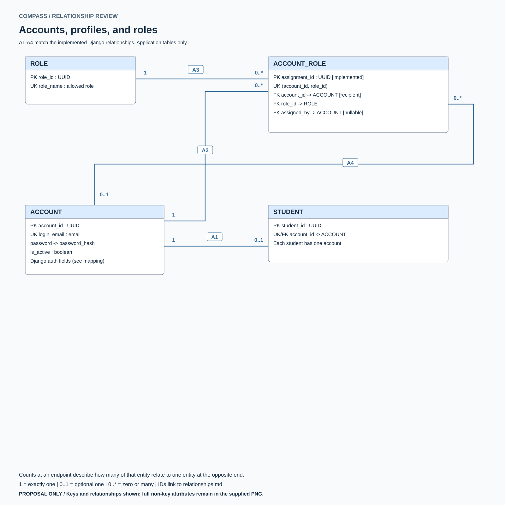
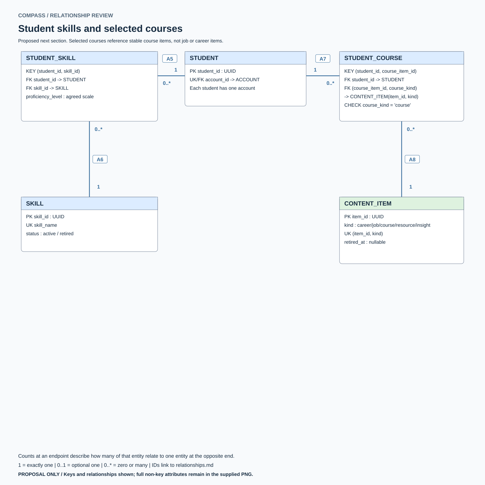
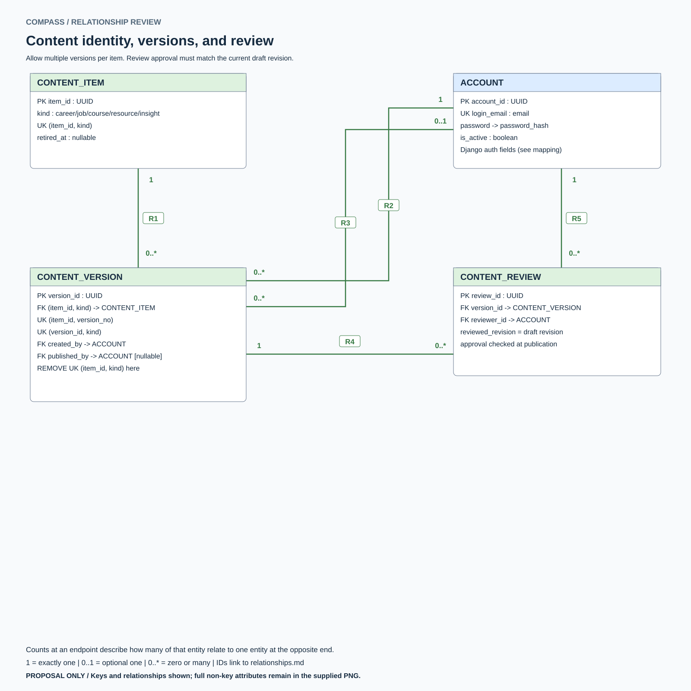
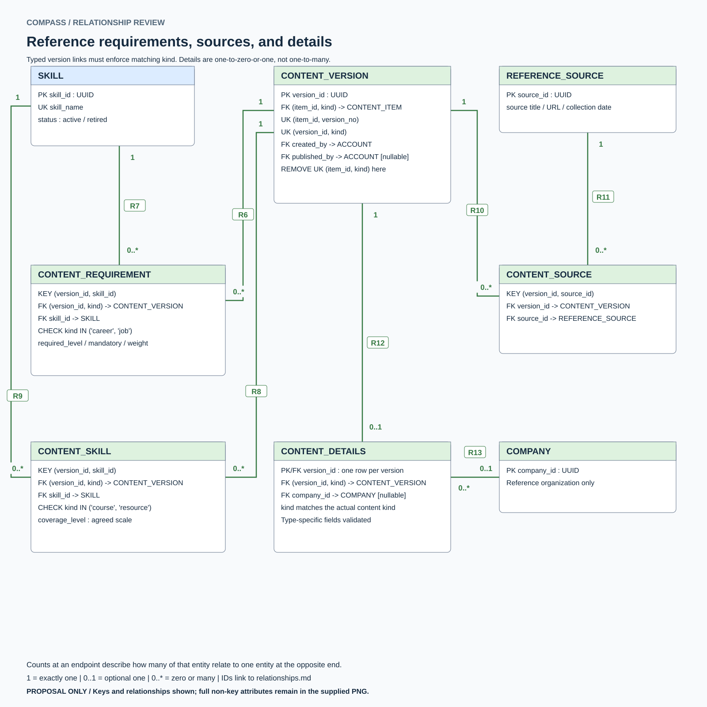
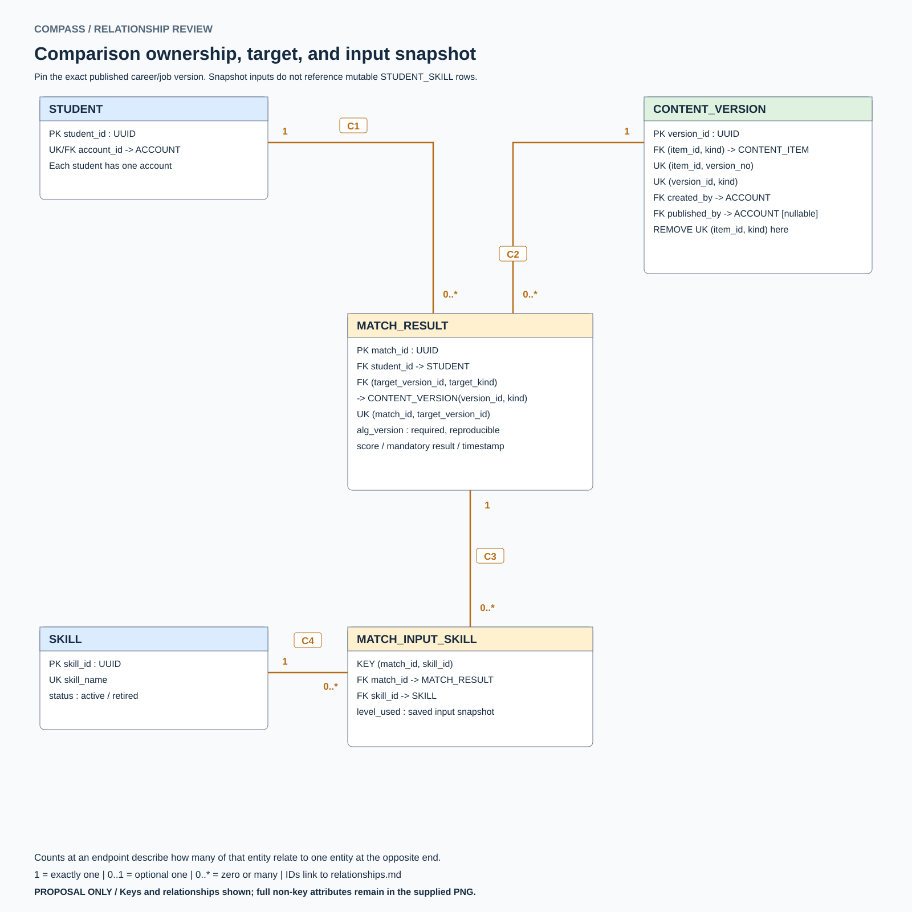
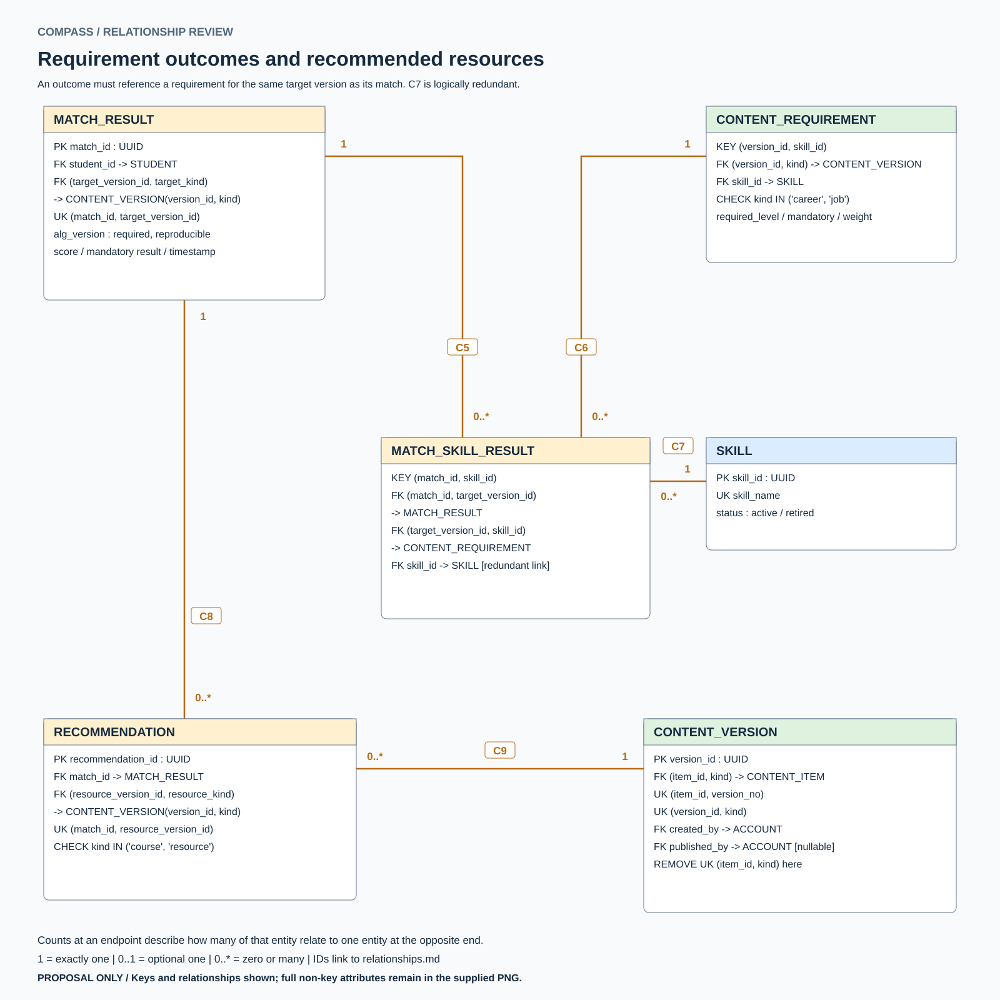
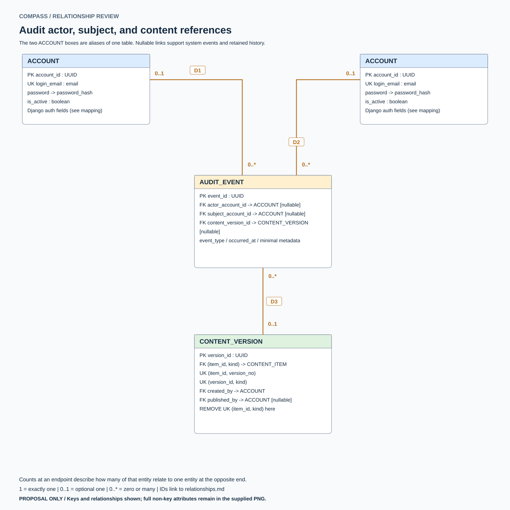

# ERD relationship catalog

Proposed relationship completion, November 1, 2026. A1-A4 are implemented; all other relationships are design proposals. No schema changes are applied.

Each row runs from referenced parent to referencing child. The counts state parents per child and children per parent, respectively. Child minimum zero allows drafts and unused reference rows; publication/completion rules can require more.

| ID | Parent | Child | Parents per child | Children per parent | FK in child | Parent deletion policy | Status |
| --- | --- | --- | --- | --- | --- | --- | --- | --- |
| A1 | ACCOUNT | STUDENT | 1 | 0..1 | `account_id` | CASCADE | Implemented |
| A2 | ACCOUNT | ACCOUNT_ROLE | 1 | 0..* | `account_id (recipient)` | CASCADE | Implemented |
| A3 | ROLE | ACCOUNT_ROLE | 1 | 0..* | `role_id` | PROTECT | Implemented |
| A4 | ACCOUNT | ACCOUNT_ROLE | 0..1 | 0..* | `assigned_by (assigner)` | SET_NULL | Implemented |
| A5 | STUDENT | STUDENT_SKILL | 1 | 0..* | `student_id` | CASCADE | Proposed |
| A6 | SKILL | STUDENT_SKILL | 1 | 0..* | `skill_id` | PROTECT; retire skill | Proposed |
| A7 | STUDENT | STUDENT_COURSE | 1 | 0..* | `student_id` | CASCADE | Proposed |
| A8 | CONTENT_ITEM | STUDENT_COURSE | 1 | 0..* | `(course_item_id, course_kind) -> (item_id, kind)` | PROTECT; retire item | Proposed |
| R1 | CONTENT_ITEM | CONTENT_VERSION | 1 | 0..* | `(item_id, kind)` | PROTECT; retire item | Proposed |
| R2 | ACCOUNT | CONTENT_VERSION | 1 | 0..* | `created_by` | PROTECT attribution | Proposed |
| R3 | ACCOUNT | CONTENT_VERSION | 0..1 | 0..* | `published_by` | PROTECT attribution | Proposed |
| R4 | CONTENT_VERSION | CONTENT_REVIEW | 1 | 0..* | `version_id` | PROTECT history | Proposed |
| R5 | ACCOUNT | CONTENT_REVIEW | 1 | 0..* | `reviewer_id` | PROTECT attribution | Proposed |
| R6 | CONTENT_VERSION | CONTENT_REQUIREMENT | 1 | 0..* | `(version_id, kind); career/job only` | PROTECT history | Proposed |
| R7 | SKILL | CONTENT_REQUIREMENT | 1 | 0..* | `skill_id` | PROTECT; retire skill | Proposed |
| R8 | CONTENT_VERSION | CONTENT_SKILL | 1 | 0..* | `(version_id, kind); course/resource only` | PROTECT history | Proposed |
| R9 | SKILL | CONTENT_SKILL | 1 | 0..* | `skill_id` | PROTECT; retire skill | Proposed |
| R10 | CONTENT_VERSION | CONTENT_SOURCE | 1 | 0..* | `version_id` | PROTECT published history | Proposed |
| R11 | REFERENCE_SOURCE | CONTENT_SOURCE | 1 | 0..* | `source_id` | PROTECT referenced source | Proposed |
| R12 | CONTENT_VERSION | CONTENT_DETAILS | 1 | 0..1 | `(version_id, kind); version_id unique` | PROTECT published history | Proposed |
| R13 | COMPANY | CONTENT_DETAILS | 0..1 | 0..* | `company_id; job details only` | PROTECT referenced company | Proposed |
| C1 | STUDENT | MATCH_RESULT | 1 | 0..* | `student_id` | Private-data deletion workflow | Proposed |
| C2 | CONTENT_VERSION | MATCH_RESULT | 1 | 0..* | `(target_version_id, target_kind); career/job` | PROTECT compared version | Proposed |
| C3 | MATCH_RESULT | MATCH_INPUT_SKILL | 1 | 0..* | `match_id` | CASCADE with private result | Proposed |
| C4 | SKILL | MATCH_INPUT_SKILL | 1 | 0..* | `skill_id` | PROTECT historical input | Proposed |
| C5 | MATCH_RESULT | MATCH_SKILL_RESULT | 1 | 0..* | `(match_id, target_version_id)` | CASCADE with private result | Proposed |
| C6 | CONTENT_REQUIREMENT | MATCH_SKILL_RESULT | 1 | 0..* | `(target_version_id, skill_id) -> (version_id, skill_id)` | PROTECT requirement history | Proposed |
| C7 | SKILL | MATCH_SKILL_RESULT | 1 | 0..* | `skill_id (redundant when C6 enforced)` | PROTECT; optional direct FK | Proposed |
| C8 | MATCH_RESULT | RECOMMENDATION | 1 | 0..* | `match_id` | CASCADE with private result | Proposed |
| C9 | CONTENT_VERSION | RECOMMENDATION | 1 | 0..* | `(resource_version_id, resource_kind); course/resource` | PROTECT recommended version | Proposed |
| D1 | ACCOUNT | AUDIT_EVENT | 0..1 | 0..* | `actor_account_id` | SET_NULL; preserve minimal event | Proposed |
| D2 | ACCOUNT | AUDIT_EVENT | 0..1 | 0..* | `subject_account_id` | SET_NULL; preserve minimal event | Proposed |
| D3 | CONTENT_VERSION | AUDIT_EVENT | 0..1 | 0..* | `content_version_id` | SET_NULL; preserve minimal event | Proposed |

Deletion policies beyond A1-A4 are proposals for the team, not applied database constraints. Private-result deletion needs an explicit lifecycle. PROTECT preserves referenced history; draft-only cleanup needs deliberate service ordering. See the review note for composite-FK and publication enforcement.

## Diagram views

### Accounts, profiles, and roles

### Student skills and selected courses

### Content identity, versions, and review

### Reference requirements, sources, and details

### Comparison ownership, target, and input snapshot

### Requirement outcomes and recommended resources

### Audit actor, subject, and content references

